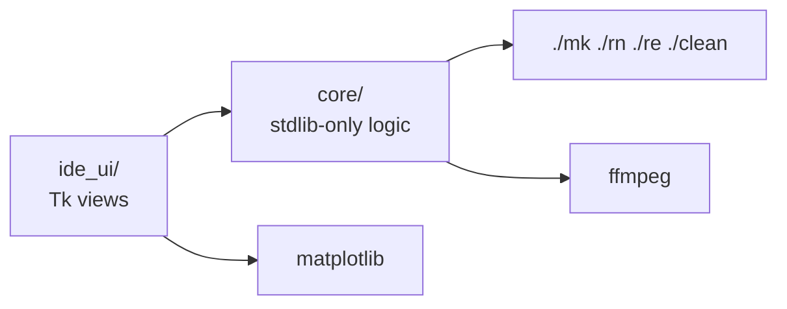

# MESA IDE — a desktop console for MESA stellar evolution

[](https://github.com/plumsakura/MESA-IDE-Console/actions/workflows/ci.yml)
[](LICENSE)
[](https://www.python.org/)

A Python/Tk desktop GUI that wraps the everyday MESA workflow — create a project
from the official `star/work` template, edit inlists, compile, run, inspect
`LOGS/`, plot HR diagrams and profiles, and render pgstar frames into a video.

> 中文说明见 [README.md](README.md)。MESA source and the MESA SDK are **not**
> bundled here; see [docs/DOWNLOADS.md](docs/DOWNLOADS.md).

## Features

| Area | What it does |
|---|---|
| Projects | Create from `$MESA_DIR/star/work` (fills `history_columns.list`, `profile_columns.list`, `png/`), or open an existing directory / one of the 105 `star/test_suite` examples |
| Editing | Multi-tab inlist editor with save-time syntax and parameter validation |
| Parameter DB | Bundled `mesa_data.db`: 4,147 MESA parameters plus an FTS5 index, double-click to copy a name |
| Build & run | Launches `./mk && ./rn` in a terminal, first asking whether to enable pgstar live output; MESA environment is loaded explicitly, not via an interactive shell |
| Run control | Restart via `./re [snapshot]` (lists and validates `photos/` snapshots) and `./clean` |
| Plots | HR track (`log_Teff`–`log_L`) and interior profile (`Rho`–`T`, log-log) in matplotlib with a zoom/save toolbar; follows `log_directory` / `photo_directory` from the inlist |
| Video | Background ffmpeg job turning `png/<prefix>_*.png` into mp4, with frame-sequence validation before encoding |
| Fonts | Bundles full Noto Sans SC and Noto Sans Mono CJK SC (~44,800 glyphs each, SIL OFL) so a blank WSL2 install renders Chinese correctly |
| Installer | `install.sh` + `IDE/install.py`: platform check → system packages → venv → deps → MESA → fonts → data → launcher → self-test; idempotent, never silently `sudo` |

## Architecture



The layering is enforced by AST checks in `IDE/tests/test_architecture_guards.py`:
`core/` may not import `tkinter` or `matplotlib`, and `ide_ui/` may not touch
`sqlite3` or `subprocess` directly. See [docs/ARCHITECTURE.md](docs/ARCHITECTURE.md).

## Quick start

```bash
git clone https://github.com/plumsakura/MESA-IDE-Console.git
cd MESA-IDE-Console
bash install.sh --yes
./IDE/run_mesa.sh
```

MESA itself (≈2 GB source, plus the SDK) must be downloaded separately and
compiled once; the installer can do it if the archives are present.

## Testing

```bash
cd IDE
./run_tests.sh            # stdlib unittest, no third-party test runner
xvfb-run -a ./run_tests.sh  # headless
```

## Repository layout

```
install.sh        bootstrap for a blank system
IDE/              application: main.py, install.py, core/, ide_ui/, tests/, assets/
docs/             architecture, testing, downloads, development notes
packaging/        one-shot installer that also builds MESA
```

## Credits

Earlier versions were published as `IDE.zip` in
[plumsakura/MESA-IDE](https://github.com/plumsakura/MESA-IDE); this repository is
the reorganized, refactored and documented successor. MESA is developed by the
MESA team — no MESA or MESA SDK archives are redistributed here.

## License

[MIT](LICENSE).
