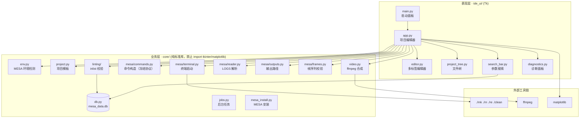

# MESA IDE · MESA 恒星演化图形化操作台

[](https://github.com/plumsakura/MESA-IDE-Console/actions/workflows/ci.yml)
[](LICENSE)
[](https://www.python.org/)
[](#环境要求)

> 用 Python/Tk 写的桌面图形界面，把 MESA 恒星演化模拟的命令行工作流——建项目、
> 改 inlist、编译、运行、看数据、出图、出视频——收进一个窗口里。

MESA（Modules for Experiments in Stellar Astrophysics）本身是 Fortran 程序，
日常使用要在终端里反复敲 `./mk`、`./rn`、`./re`，用文本编辑器改 `inlist`，
再写 Python 脚本从 `LOGS/` 里取数画图。**MESA IDE** 把这些步骤图形化：
左侧项目文件树、多标签编辑器、参数搜索、一键编译运行、HR 图与内部剖面、
以及把 pgstar 输出的 PNG 序列合成演化视频。

<!-- 建议在此处补一张界面截图：docs/images/screenshot-main.png -->

---

## 目录

- [项目背景](#项目背景)
- [功能特性](#功能特性)
- [界面与架构](#界面与架构)
- [环境要求](#环境要求)
- [快速开始](#快速开始)
- [安装](#安装)
- [使用](#使用)
- [项目结构](#项目结构)
- [工程实践](#工程实践)
- [测试](#测试)
- [文档](#文档)
- [已知限制](#已知限制)
- [来源与致谢](#来源与致谢)
- [许可证](#许可证)

---

## 项目背景

恒星演化模拟的门槛不只在物理，也在工具链：MESA 的官方模板 `star/work`
要求用户记住十几条命令、若干环境变量，以及 `inlist` 里几千个参数的名字和语义。
初学者最常见的失败不是物理设错，而是路径、环境变量、编译顺序出错。

这个项目把「操作台」作为设计目标：**命令行能做的，界面上也能点**，并且每一步
都把将要执行的命令原样展示出来，出错时给出可复制的修复命令，而不是抛一堆栈。

## 功能特性

| 功能 | 说明 |
|---|---|
| 项目管理 | 从 `$MESA_DIR/star/work` 官方模板创建新项目（自动补齐 `history_columns.list` / `profile_columns.list` 并建 `png/`）；打开已有项目目录树，双击打开编辑 |
| 多标签编辑 | 同时编辑多个 `inlist` 文件，保存前做语法 / 参数校验 |
| 参数库与搜索 | 内置 `mesa_data.db`：4147 个 MESA 参数 + FTS5 全文索引，双击复制参数名 |
| 编译运行 | 在新终端里执行 `./mk && ./rn`；点击时先询问是否开启 pgstar 实时绘图（写官方 `*_win_flag` 控制项）；MESA 环境由终端命令显式加载，不依赖交互式 shell |
| 运行控制 | 重启 `./re [快照名]`（列出 `photos/` 中可用快照并校验名字）、清理 `./clean` |
| 可视化 | HR 图轨迹（`log_Teff`–`log_L`）与内部剖面（`Rho`–`T`，loglog），matplotlib 渲染并带缩放 / 保存工具栏；自动跟随 inlist 中的 `log_directory`、`photo_directory` 等设置 |
| 视频合成 | 用 ffmpeg 把 `png/<prefix>_*.png` 合成 mp4，后台任务不阻塞界面；合成前校验帧序列完整性与顺序 |
| 中文字体 | 随包自带完整版 Noto Sans SC / Noto Sans Mono CJK SC（各约 44,800 字形，SIL OFL），空白 WSL2 装完即可正常显示中文 |
| 环境自检 | 启动面板显示 MESA 是否可用；`MESA_DIR` 失效时按常见布局自动扫描真实安装目录，并从 `star/work`、`star/test_suite` 找参考项目 |
| 安装器 | `install.sh` + `IDE/install.py`：平台自检 → 系统依赖 → venv → 依赖 → MESA → 字体 → 数据 → 启动脚本 → 自检，全程幂等 |

## 界面与架构



分层的硬约束写在 `IDE/core/__init__.py` 的模块说明里，并由
`tests/test_architecture_guards.py` 用 AST 静态检查强制执行：`core/` 只允许
标准库、不得 import `tkinter` / `matplotlib`；`ide_ui/` 不得直接 import
`sqlite3` / `subprocess`。这样核心逻辑可以在无图形环境（CI、SSH）里单独测。

详见 [docs/ARCHITECTURE.md](docs/ARCHITECTURE.md)。

## 环境要求

| 项目 | 要求 |
|---|---|
| 系统 | Linux（推荐 WSL2 + WSLg，Windows 11）；macOS 可运行但未完整验证 |
| Python | 3.8+（自带 `tkinter`） |
| 图形 | X11 / Wayland；WSL2 需要 WSLg 或自行配置 X server |
| MESA | 编译与运行 MESA 项目时必需；仅浏览 / 编辑不需要 |
| 磁盘 | 装好 MESA 约需 20 GB 以上 |
| 可选 | `ffmpeg`（视频合成）、`unzip`（解压 MESA 归档） |

> **MESA 源码（约 2 GB）与 MESA SDK 不随本仓库分发。** 请按
> [docs/DOWNLOADS.md](docs/DOWNLOADS.md) 从官方网站下载对应版本，放到安装器
> 能找到的位置即可（安装器会自动解压、编译并生成 `mesa_env.sh`）。

## 快速开始

```bash
git clone https://github.com/plumsakura/MESA-IDE-Console.git
cd MESA-IDE-Console

bash install.sh --yes          # 装依赖、建 venv、装字体、找 MESA
./IDE/run_mesa.sh              # 启动
```

`install.sh` 会先体检 Python / `venv` / `tkinter`，缺什么按发行版给出安装命令
（加 `--yes` 才会自动 `sudo` 装系统包）；真正的安装在 `IDE/install.py` 里完成。

## 安装

### 方式 A：源码仓库（推荐）

见[快速开始](#快速开始)。常用开关：

```bash
bash install.sh --doctor     # 只体检，不安装任何东西
bash install.sh --no-sudo    # 绝不调用 sudo，只打印需要装的包
bash install.sh --yes        # 无人值守
```

### 方式 B：完整安装包（含 MESA + SDK 归档）

若已按 [docs/DOWNLOADS.md](docs/DOWNLOADS.md) 下载好 `mesa-<版本>.zip` 和
`mesasdk-x86_64-linux-*.tar.gz`，把它们与本仓库的 `packaging/install-all.sh`
放在同一目录，然后：

```bash
bash install-all.sh --yes            # 补依赖 → 解压 → 编译 MESA → 装 IDE
bash install-all.sh --skip-build     # 只装 IDE + 解压源码，不编译
```

详见 [packaging/README.md](packaging/README.md)。

### 方式 C：源码压缩包

不想用 git 时，从 [Releases](https://github.com/plumsakura/MESA-IDE-Console/releases)
下载该版本自动生成的 `Source code (tar.gz)`（约 27 MB，仅源码与字体，**不含**
MESA / MESA SDK）：

```bash
tar -xzf MESA-IDE-Console-1.1.tar.gz
cd MESA-IDE-Console-1.1
bash install.sh --yes
```

## 使用

1. 启动后，面板顶部显示 MESA 状态（可用 / 不可用 + 路径）；
2. 「创建新项目」从官方 `star/work` 复制模板并起名；「打开老项目」可选择已有目录，
   也能从 `star/test_suite` 的 105 个示例里挑；
3. 在编辑器里改 `inlist` → 工具栏「保存并检查」；
4. 「编译运行」→ 弹窗询问是否实时画图 → 在终端里跑 `./mk && ./rn`；
5. 运行中或结束后：`LOGS/` 是 history / profile 数据，「HR图轨迹」「内部剖面」
   随时出图；`photos/` 是快照，「重启」可 `./re` 回到某个模型；
6. 「生成视频」：先在 `inlist_pgstar` 打开文件输出（`HR_file_flag = .true.` 等），
   再输入图片前缀（默认 `hr`）合成 mp4。

## 项目结构

```
MESA-IDE-Console/
├── install.sh                 # 空白系统引导脚本（找 Python / venv / tk 后交给 install.py）
├── IDE/                       # 应用本体
│   ├── main.py                # 启动面板
│   ├── install.py             # 安装器（平台自检 → 依赖 → MESA → 字体 → 自检）
│   ├── core/                  # 业务层：环境、项目、命令、数据读取、视频（纯标准库）
│   ├── ide_ui/                # 表现层：主窗口、编辑器、文件树、搜索、诊断
│   ├── assets/fonts/          # 自带中文字体（SIL OFL）
│   ├── mesa_data.db           # 4147 个 MESA 参数 + FTS5 索引
│   ├── tests/                 # 29 个测试模块
│   └── mesa使用文档/           # MESA 官方手册中英对照（26.4.1）
├── docs/                      # 架构、测试、下载、开发记录
├── packaging/                 # 一键安装脚本（配合官方 MESA / SDK 归档）
└── .github/workflows/ci.yml   # 语法与静态检查
```

## 工程实践

这个项目除了功能，也是一次**以可维护性为目标的重构练习**：

- **分层与守卫**：`core`（纯逻辑）/ `ide_ui`（Tk 视图）/ 入口脚本三层，依赖方向
  由 `test_architecture_guards.py` 的 AST 检查强制，避免业务逻辑再次渗进界面代码；
- **协议冻结**：`core/mesa/commands.py` 里「按钮 → 命令」的对应关系被声明为
  FROZEN PROTOCOL，`test_protocol_snapshot.py` 对其做快照测试，改动必须显式说明；
- **不拼 shell 字符串**：所有外部命令走 argv 列表（`shell=False`），路径统一经
  `shlex.quote` / 参数列表转义，避免路径里的空格与引号造成的注入与解析错误；
- **后台任务抽象**：`core/jobs.py` 统一 `Popen` 生命周期、输出回调与取消，避免
  长任务卡死 UI 线程，也避免孤儿进程；
- **快照测试 + 真实数据**：`tests/fixtures/` 同时提供合成项目与真实 MESA 输出样本，
  解析器对格式变化的回归有据可查；
- **可移植安装**：安装器不假定系统、不静默 `sudo`、幂等可重跑，失败时打印可复制的
  修复命令。

更完整的过程记录见 [docs/DEVELOPMENT.md](docs/DEVELOPMENT.md) 与
[docs/PROJECT_NOTES.md](docs/PROJECT_NOTES.md)。

## 测试

```bash
cd IDE
./run_tests.sh                                  # 全部（标准库 unittest，无第三方测试依赖）
venv/bin/python -m unittest tests.test_core_env # 单个模块
xvfb-run -a ./run_tests.sh                      # 无 X11 的 CI / 服务器
```

无图形环境时 Tk 相关用例自动跳过。测试覆盖核心逻辑（环境检测、inlist 校验、
`LOGS` 解析、命令构造、视频帧校验、任务并发）与界面组件，详见
[docs/TESTING.md](docs/TESTING.md)。

## 文档

| 文档 | 内容 |
|---|---|
| [docs/DOWNLOADS.md](docs/DOWNLOADS.md) | MESA 24.08.1 / MESA SDK 24.7.1 官方下载与放置方式 |
| [docs/ARCHITECTURE.md](docs/ARCHITECTURE.md) | 分层、模块职责、数据流、关键设计决策 |
| [docs/TESTING.md](docs/TESTING.md) | 测试结构、运行方式、快照与守卫测试 |
| [docs/DEVELOPMENT.md](docs/DEVELOPMENT.md) | 重构阶段、约定与开发流程 |
| [docs/PROJECT_NOTES.md](docs/PROJECT_NOTES.md) | 项目总结：目标、难点、取舍与收获 |
| [INSTALL.md](INSTALL.md) | 安装说明（发行包视角） |
| [IDE/mesa使用文档/](IDE/mesa使用文档/README.md) | MESA 官方手册中英对照 + 功能速查 |

## 已知限制

- **pgstar 实时绘图窗口在 WSL2 下暂不弹出**：`./rn` 与数据输出正常，只是图形窗口
  不显示；「编译运行」的询问与官方 `*_win_flag` 开关已就位，属待修复项；
- 部分 MESA 语义校验是启发式的，数组型参数可能误报；
- 主要面向 Linux / WSL2 测试，macOS 可用但未系统验证。

## 来源与致谢

- 本项目早期版本以 `IDE.zip` 的形式发布在
  [plumsakura/MESA-IDE](https://github.com/plumsakura/MESA-IDE)；当前仓库是在其
  基础上整理、分层重构并补全文档与测试后的版本，两者功能同源；
- MESA 由 MESA 团队开发（[MESAHub/mesa](https://github.com/MESAHub/mesa)），
  使用请遵守其许可；本仓库**不包含** MESA 源码、MESA SDK 或任何第三方归档；
- 内置 Noto Sans SC / Noto Sans Mono CJK SC 字体来自 Google Noto 项目，
  依 SIL Open Font License 1.1 分发（见 [IDE/assets/fonts/OFL.txt](IDE/assets/fonts/OFL.txt)）；
- `IDE/mesa使用文档/` 中的英文正文取自 MESA 官方文档（26.4.1），中文为对照翻译，
  版权归 MESA 团队所有。

## 许可证

源码以 [MIT License](LICENSE) 发布。
